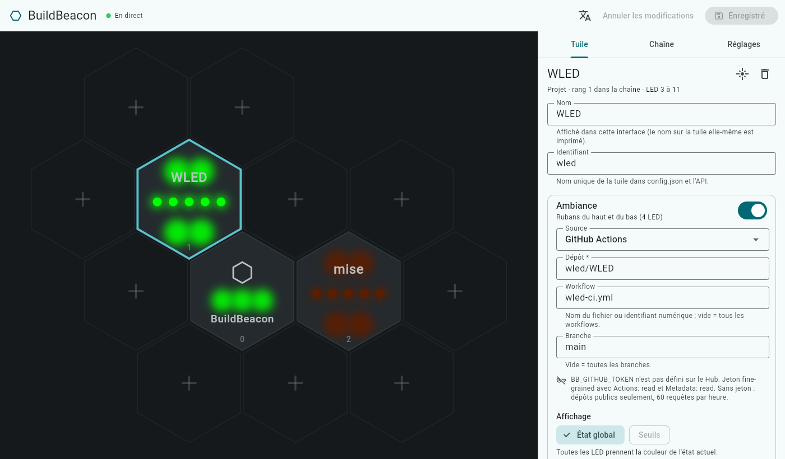

<!-- BuildBeacon — README (français). Version 1.9 (2026-11-12) — onglet Impression 3D. -->
# BuildBeacon

[](https://github.com/devcafeine/buildbeacon/actions/workflows/check.yml)
[](LICENSE)

**Un mur de tuiles hexagonales lumineuses qui affiche l'état de vos GitHub Actions — et
tout ce qu'un plugin sait lire.**

[English version](README.md)

Chaque tuile, imprimée en 3D, a ses propres LED. Une tuile suit un projet : ses rubans du
haut et du bas prennent la couleur de l'état global (vert, rouge, orange qui pulse pendant
un run), et ses cinq points montrent les cinq derniers runs. La tuile master, qui contient
l'ESP32, affiche l'état du système.

> **État : début du développement.** Le Hub tourne à partir de `config.json` : plugin
> GitHub, rendu des LED, sortie vers WLED, rechargement à chaud de la configuration, API
> REST, interface web et image Docker, plus un simulateur et une mire.

## Fonctionnement

```
API GitHub ──(scrutation, ETag)──┐
                                 ▼
              ┌──────────── Hub (Dart) ─────────────┐
              │  plugins de source → cache d'états  │
              │        ↓                            │
              │  image des LED (20 img/s)           │──DDP/UDP──▶ ESP32 + WLED ──▶ tuiles
              │  API REST · interface web           │
              └─────────────────────────────────────┘
```

- **Matériel** : LED WS2812B sur une seule ligne de données, pilotées par un ESP32-C3 sous
  [WLED](https://kno.wled.ge/). Pas de firmware maison : WLED reçoit seulement les couleurs.
- **Hub** : un programme Dart (bientôt en image Docker) qui lit les sources grâce à des
  **plugins**, calcule la couleur de chaque LED et envoie les images à WLED en DDP.
- **Plugins** : GitHub Actions d'abord. Chacun peut ajouter une source (une autre CI, une
  imprimante 3D, un service web…) avec le SDK des plugins — voir
  [Écrire un plugin](docs/writing-a-plugin.fr.md).

## Les tuiles

| Tuile | LED | Zones |
|---|---|---|
| Master (logo, contient l'ESP32) | 3 | `system` |
| Tuile projet | 9 | `ambient` : rubans du haut et du bas (4 LED) · `dots` : 5 points (gauche → droite) |

Les tuiles sont chaînées dans l'ordre du câblage : la master d'abord (LED 0 à 2), puis la
tuile projet n° k occupe les LED `3 + 9·(k−1)` à `3 + 9·k − 1`. L'ordre de câblage ne dépend
pas de la place au mur : `config.json` garde les deux.

Modes d'affichage : `overall` (couleur de l'état actuel), `history` (5 derniers runs sur les
points), `thresholds` (une mesure comparée à des seuils), `gauge` (barre de progression sur
les points).

Les modèles 3D (OpenSCAD) et les cartes électroniques (KiCad) sont dans
[`hardware/`](hardware/README.fr.md), sous CERN-OHL-P-2.0.

## Démarrage rapide (développeurs)

Prérequis : [mise](https://mise.jdx.dev/), qui installe le bon SDK Flutter/Dart.

```sh
git clone https://github.com/devcafeine/buildbeacon.git
cd buildbeacon
mise install        # Flutter 3.47.6 (Dart 3.13.5)
mise run get        # dépendances de tout l'espace de travail
mise run check      # format, analyse statique, tests
```

### Sans matériel : le simulateur

Le simulateur est un faux WLED qui montre les tuiles dans une page web.

```sh
mise run simulator -- --open                    # terminal 1 : http://localhost:8090
mise run test-pattern -- --host 127.0.0.1       # terminal 2 : envoie une mire
```

Options : `mise run simulator -- --help`. Ajouter `--config <config.json>` pour voir votre
vraie disposition, `--terminal` pour dessiner dans le terminal.

### Lancer le Hub

```sh
mise run ui-build   # une fois : l'interface web
mise run hub        # puis ouvrir http://localhost:8080
```

À son premier démarrage, le Hub crée `data/config.json` avec la tuile master seule.
Ouvrez ensuite **http://localhost:8080** : le mur dessiné à sa vraie place, avec les
couleurs en direct. Touchez une tuile pour choisir la source et le mode d'affichage de
chaque zone ; ajoutez une tuile avec un **+**, déplacez-la en la faisant glisser, réglez
l'ordre de la chaîne, WLED, la luminosité et les couleurs. Vos modifications s'affichent
sur le mur et sont vérifiées par le Hub pendant la saisie ; rien n'arrive aux LED avant
d'**enregistrer**. Langue : français ou anglais (menu, ou `?lang=en`).

L'onglet **Impression 3D** liste les pièces à imprimer pour votre mur (une coque par
tuile avec son nom, les plaques arrière, les os de chien qui les relient) et télécharge les
jeux de paramètres OpenSCAD correspondants pour le modèle de
[`hardware/cad`](hardware/README.fr.md), avec les commandes qui rendent toutes les pièces.



Pour partir plutôt d'un exemple : [`config.example.json`](config.example.json) suit trois
projets publics — BuildBeacon lui-même (tuile master), WLED et mise — et ne demande pas de
jeton. Copiez-le avant de lancer le Hub : `mkdir -p data && cp config.example.json
data/config.json`.

**Sans tuiles**, le simulateur joue le rôle de WLED dans une page web : dans l'interface,
onglet **Réglages**, mettez l'adresse WLED à `127.0.0.1` et enregistrez, puis dans un autre
terminal :

```sh
mise run simulator -- --open --config "$PWD/data/config.json"
```

Le simulateur suit `data/config.json` : les tuiles ajoutées, déplacées ou renommées dans
l'interface apparaissent à leur place, sans recharger la page. Le Hub recharge `data/config.json` dès qu'il est enregistré,
depuis l'interface ou à la main, et refuse une version invalide (la précédente est gardée).

Le Hub sert aussi son API REST sur http://localhost:8080/api (`--port` pour en changer) :

```sh
curl http://localhost:8080/api/state        # ce que montrent les tuiles, en JSON
curl -X POST http://localhost:8080/api/tiles/wled/identify \
     -H 'Content-Type: application/json' -d '{}'   # faire clignoter une tuile
```

Voir [API REST](docs/api.fr.md) : routes, événements en direct, sécurité (`BB_API_TOKEN`).

Sans jeton, GitHub autorise 60 requêtes par heure : l'exemple interroge toutes les 180 s
pour ses 3 sources, et le Hub vous prévient si votre configuration en demande plus. Avec
un jeton (`cp .env.example .env`, puis remplir `BB_GITHUB_TOKEN`), vous pouvez descendre
à 30 s et suivre des dépôts privés.

### Avec les tuiles

1. Installer [WLED](https://install.wled.me/) sur l'ESP32-C3, puis dans son interface web :
   - *LED Preferences* : GPIO de données 4, type WS281x, ordre GRB, longueur = 3 + 9 × nombre
     de tuiles projet, courant maximal de votre alimentation ;
   - *WiFi Setup* : votre réseau, nom mDNS `buildbeacon` (→ `buildbeacon.local`) ;
   - *Sync Interfaces* : « Receive UDP realtime » activé (par défaut).
2. Vérifier le câblage et relever l'ordre de chaînage :
   `mise run test-pattern -- --host buildbeacon.local` (ou l'IP de WLED).
3. Lancer `mise run hub` et décrire vos tuiles dans l'interface web : leur place au mur (en
   les faisant glisser) et l'ordre de câblage (onglet **Chaîne** ; *identifier* fait
   clignoter une tuile). Le Hub vérifie WLED (nombre de LED) et règle sa luminosité.

## Sur quel matériel le Hub tourne-t-il ?

Le Hub est un petit programme natif : très peu de processeur, environ 50 Mo de mémoire. Il
doit être sur le même réseau que WLED (UDP 4048, HTTP 80) et joindre Internet pour les
sources.

| Matériel | Pris en charge | Remarques |
|---|---|---|
| Mini PC, serveur ou NAS, Linux x86-64 | oui | recommandé : allumé en permanence, [avec Docker](#installer-avec-docker-linux) |
| Raspberry Pi 3, 4, 5, Zero 2 W avec un système 64 bits (arm64) | oui | un bon choix sans serveur ; Docker aussi |
| Raspberry Pi 2 ou 3 avec un système 32 bits (ARMv7) | oui | image Docker publiée |
| macOS, Windows, Linux de bureau | oui | pour développer ou essayer |
| Raspberry Pi 1, Zero, Zero W (ARMv6) | non | Dart ne prend pas en charge l'ARMv6 |
| ESP32 et autres microcontrôleurs | non | l'ESP32 fait tourner WLED et reçoit seulement les couleurs |

Testé à ce jour : macOS (Apple Silicon), Linux x86-64 (CI) et l'image Docker (x86-64 dans
la CI, arm64 avec OrbStack ; images arm64 et ARMv7 construites et publiées par la CI). Les autres
plateformes sont prises en charge par Dart mais pas encore testées : vos retours sont
bienvenus.

## Installer avec Docker (Linux)

L'installation conseillée : une machine Linux allumée en permanence, sur le même réseau que
WLED — mini PC, serveur, Raspberry Pi 4 ou 5 avec un système 64 bits.

L'image est publiée sur GitHub pour x86-64, arm64 et ARMv7
([`ghcr.io/devcafeine/buildbeacon-hub`](https://github.com/devcafeine/buildbeacon/pkgs/container/buildbeacon-hub)) :
deux fichiers suffisent, inutile de cloner le dépôt.

```sh
mkdir buildbeacon && cd buildbeacon
curl -fsSLO https://raw.githubusercontent.com/devcafeine/buildbeacon/main/docker-compose.yml
curl -fsSL -o .env https://raw.githubusercontent.com/devcafeine/buildbeacon/main/.env.example
# facultatif, dans .env : BB_GITHUB_TOKEN, BB_LANG=fr, BB_PORT…
docker compose pull && docker compose up -d
```

Ouvrez ensuite **http://<adresse de la machine>:8080**. À son premier démarrage, le Hub
crée sa configuration avec la tuile master seule, dans le volume `buildbeacon-data` : tout
le reste se règle dans l'interface web.

- **Réseau** : le conteneur utilise le réseau de la machine (`network_mode: host`) ; les
  images des LED arrivent donc à WLED en UDP et `buildbeacon.local` est trouvé par mDNS,
  comme hors de Docker. L'interface écoute sur le port 8080 ; `BB_PORT` dans `.env` pour
  en changer.
- **Mise à jour** : `docker compose pull && docker compose up -d`. **Journal** :
  `docker compose logs -f`.
- **Versions** : `latest` suit la branche principale ; chaque version a aussi sa propre
  étiquette (`ghcr.io/devcafeine/buildbeacon-hub:0.2.0`) : mettez-la dans
  `docker-compose.yml` à la place de `latest` pour rester sur une version, ou y revenir.
- **L'image** (environ 40 Mo) contient seulement le Hub compilé et son interface, et tourne
  avec un utilisateur sans privilèges. Les secrets restent dans `.env`, hors de l'image et
  du volume.
- **La construire à partir des sources** plutôt : clonez le dépôt (`git clone`), puis
  `docker compose up -d --build` dedans. Comptez quelques minutes la première fois (elle
  télécharge Flutter pour compiler l'interface) et environ 2 Go de mémoire, sur une machine
  Linux x86-64 ou arm64.
- **Sur macOS ou Windows**, Docker tourne dans une machine virtuelle : indiquez l'adresse IP
  de WLED, mDNS n'atteignant pas le réseau local depuis celle-ci. Pour essayer BuildBeacon
  sur ces systèmes, `mise run hub` est plus simple.

## Configuration

`config.json` (modifiable depuis l'interface web, à la main ou par
l'[API REST](docs/api.fr.md)) :

```json
{
  "version": 1,
  "wled": { "host": "buildbeacon.local", "brightness": 128 },
  "poll_seconds": 30,
  "tiles": [
    { "id": "master", "label": "BuildBeacon", "kind": "master", "chain_index": 0,
      "pos": { "q": 0, "r": 1 }, "zones": { "system": null } },
    { "id": "app", "label": "App", "kind": "project", "chain_index": 1,
      "pos": { "q": 0, "r": 0 },
      "zones": {
        "ambient": { "source": { "type": "github", "repo": "owner/app", "workflow": "ci.yml" },
                     "mode": "overall" },
        "dots":    { "source": { "type": "github", "repo": "owner/app", "workflow": "ci.yml" },
                     "mode": "history" } } }
  ]
}
```

Les secrets ne vont jamais dans `config.json` : le jeton GitHub (*fine-grained*, lecture
seule, *Actions: read* et *Metadata: read*) passe par la variable d'environnement
`BB_GITHUB_TOKEN` — voir [`.env.example`](.env.example). L'API REST ne renvoie jamais de
secret.

## Langues

Les interfaces existent en anglais et en français (`BB_LANG=fr` ou `BB_LANG=en` pour les
outils en ligne de commande ; pour les pages web, la langue du navigateur ou le menu des
langues). Les plugins apportent leurs propres traductions.

## Le dépôt

```
hub/                 espace de travail Dart
  sdk/               SDK des plugins (seule dépendance d'un plugin)
  core/              modèle, rendu des LED, registre des plugins
  plugins/github/    plugin GitHub Actions
  server/            le Hub (bin/hub.dart), API REST, sortie DDP, simulateur, mire
  ui/                interface web (Flutter Web), servie par le Hub
  Dockerfile         image Docker du Hub et de son interface
  tool/              new_plugin.dart (mise run new-plugin <nom>)
docs/                guides, API REST
hardware/            modèles 3D (cad/), cartes (pcb/), guide de montage
config.example.json configuration d'exemple (dépôts publics)
docker-compose.yml  le Hub dans Docker (docker compose up -d --build)
```

## Participer

Signalements de bugs, idées, plugins et traductions sont les bienvenus : voir
[CONTRIBUTING.fr.md](CONTRIBUTING.fr.md) et [Écrire un plugin](docs/writing-a-plugin.fr.md).

## Licence

Logiciel : [MIT](LICENSE). Matériel (modèles 3D, cartes, dans `hardware/`) :
[CERN-OHL-P-2.0](hardware/LICENSE). L'interface web embarque la police Roboto
([licence Apache 2.0](hub/ui/assets/fonts/Roboto_LICENSE.txt)).
