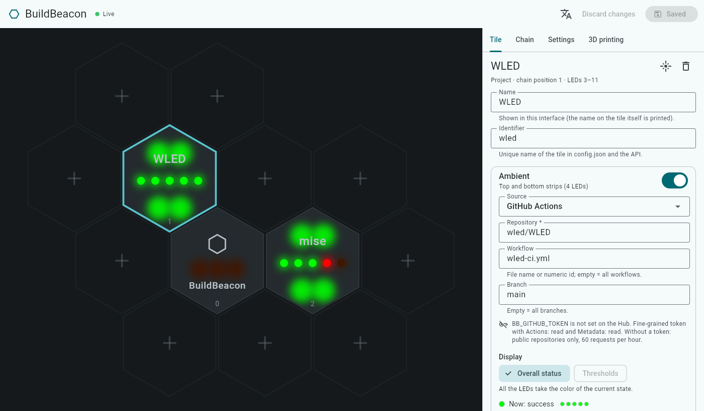
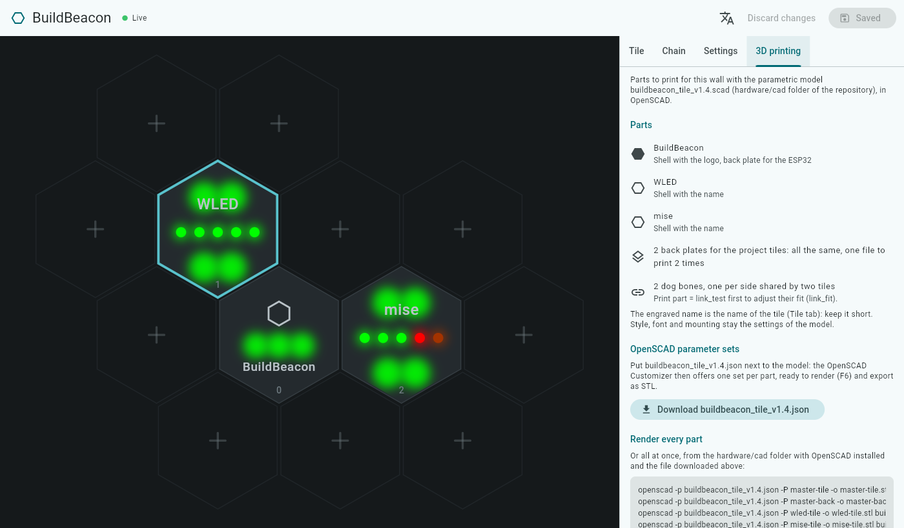

<!-- BuildBeacon — README (English). Version 1.12 (2026-11-12) — the Hub task builds the web interface when needed. -->
# BuildBeacon

[](https://github.com/devcafeine/buildbeacon/actions/workflows/check.yml)
[](LICENSE)

**A wall of glowing hexagonal tiles that shows the state of your GitHub Actions — and
anything else a plugin can read.**

[Version française](README.fr.md)

Each 3D-printed tile has its own LEDs. A tile follows a project: its top and bottom strips
glow with the overall state (green, red, pulsing orange while a run is in progress), and
its five dots show the last five runs. The master tile, which holds the ESP32, shows the
state of the system.

> **Status: early development.** The Hub runs from `config.json`: GitHub plugin, LED
> rendering, output to WLED, hot reload of the configuration, REST API, web interface and
> Docker image, plus a simulator and a test pattern.

## How it works

```
GitHub API ──(polling, ETag)──┐
                              ▼
              ┌──────────── Hub (Dart) ─────────────┐
              │  source plugins → state cache       │
              │        ↓                            │
              │  LED frame (20 fps)                 │──DDP/UDP──▶ ESP32 + WLED ──▶ tiles
              │  REST API · web interface           │
              └─────────────────────────────────────┘
```

- **Hardware**: WS2812B LEDs on a single data line, driven by an ESP32-C3 running
  [WLED](https://kno.wled.ge/). No custom firmware: WLED only receives the colors.
- **Hub**: a Dart program (Docker image) that reads the sources through **plugins**,
  computes the color of every LED and streams the frames to WLED over DDP.
- **Plugins**: GitHub Actions first. Anyone can add a source (another CI, a 3D printer, a
  web service…) with the plugin SDK — see [Writing a plugin](docs/writing-a-plugin.md).

## The tiles

| Tile | LEDs | Zones |
|---|---|---|
| Master (logo, holds the ESP32) | 3 | `system` |
| Project tile | 9 | `ambient`: top and bottom strips (4 LEDs) · `dots`: 5 dots (left → right) |

Tiles are chained in wiring order: the master first (LEDs 0–2), then project tile #k uses
LEDs `3 + 9·(k−1)` to `3 + 9·k − 1`. The wiring order is independent from the place on the
wall: `config.json` stores both.

Display modes: `overall` (color of the current state), `history` (last 5 runs on the dots),
`thresholds` (a measurement compared to thresholds), `gauge` (progress bar on the dots).

The 3D models (OpenSCAD) and circuit boards (KiCad) are in [`hardware/`](hardware/README.md),
under CERN-OHL-P-2.0.

## Quick start (developers)

Requirements: [mise](https://mise.jdx.dev/), which installs the right Flutter/Dart SDK.

```sh
git clone https://github.com/devcafeine/buildbeacon.git
cd buildbeacon
mise install        # Flutter 3.47.6 (Dart 3.13.5)
mise run get        # dependencies of the whole workspace
mise run check      # format, static analysis, tests
```

### Without hardware: the simulator

The simulator is a fake WLED that shows the tiles in a web page.

```sh
mise run simulator -- --open                    # terminal 1: http://localhost:8090
mise run test-pattern -- --host 127.0.0.1       # terminal 2: sends a test pattern
```

Options: `mise run simulator -- --help`. Add `--config <config.json>` to see your real
layout, `--terminal` to draw in the terminal.

### Run the Hub

```sh
mise run hub        # then open http://localhost:8080
```

`mise run hub` first builds the web interface if its code changed (a few seconds, skipped
when up to date). On its first start, the Hub creates `data/config.json` with the master
tile only. Then open
**http://localhost:8080**: the wall drawn at its real place, with the live
colors. Select a tile to choose the source and the display mode of each zone; add a tile
with a **+**, move it by dragging it, set the chain order, WLED, the brightness and the
colors. Your changes are previewed on the wall and checked by the Hub as you type; nothing
reaches the LEDs before you **save**. Language: English or French (menu, or `?lang=fr`).



#### 3D printing

The **3D printing** tab turns your wall into the parts to print with the parametric model
of [`hardware/cad`](hardware/README.md) (OpenSCAD):

- **the parts**: a shell per tile with its name (the master tile with the logo), the back
  plate of the master tile (it holds the ESP32), one back plate for the project tiles to
  print as many times as there are tiles (they are all the same), and the "dog bones" that
  join the back plates, one per side shared by two tiles;
- **Download** gives a parameter sets file named after the model
  (`buildbeacon_tile_vX.Y.json`): put it next to the `.scad` file, open the model in OpenSCAD, pick a part in the
  Customizer list, render (**F6**) and export to STL;
- or render every part at once: the tab gives the commands to run in `hardware/cad`
  (`openscad -p … -P mise-tile -o mise-tile.stl …`), with a copy button.

Style, font and mounting stay the settings of the model; the engraved name is the name of
the tile. Before the dog bones, print `part = link_test` once to adjust their fit.



To start from an example instead: [`config.example.json`](config.example.json) follows
three public projects — BuildBeacon itself (master tile), WLED and mise — and needs no
token. Copy it before starting the Hub: `mkdir -p data && cp config.example.json
data/config.json`.

**Without tiles**, the simulator plays the part of WLED in a web page: in the interface,
**Settings** tab, set the WLED address to `127.0.0.1` and save, then in another terminal:

```sh
mise run simulator -- --open --config "$PWD/data/config.json"
```

The simulator follows `data/config.json`: tiles added, moved or renamed in the interface
show up at their place, without a reload. The Hub reloads `data/config.json` as soon as it is saved, from the
interface or by hand, and refuses an invalid version (the previous one is kept).

The Hub also serves its REST API on http://localhost:8080/api (`--port` to change it):

```sh
curl http://localhost:8080/api/state        # what the tiles show, as JSON
curl -X POST http://localhost:8080/api/tiles/wled/identify \
     -H 'Content-Type: application/json' -d '{}'   # make a tile blink
```

See [REST API](docs/api.md): routes, live events, security (`BB_API_TOKEN`).

Without a token, GitHub allows 60 requests per hour: the example polls every 180 s for
its 3 sources, and the Hub tells you if your configuration needs more. With a token
(`cp .env.example .env`, then fill `BB_GITHUB_TOKEN`), you can go down to 30 s and follow
private repositories.

### With the tiles

1. Flash [WLED](https://install.wled.me/) on the ESP32-C3, then in its web interface:
   - *LED Preferences*: data GPIO 4, type WS281x, color order GRB, length = 3 + 9 × number
     of project tiles, maximum current of your power supply;
   - *WiFi Setup*: your network, mDNS name `buildbeacon` (→ `buildbeacon.local`);
   - *Sync Interfaces*: "Receive UDP realtime" enabled (default).
2. Check the wiring and find the chain order:
   `mise run test-pattern -- --host buildbeacon.local` (or the IP of WLED).
3. Run `mise run hub` and describe your tiles in the web interface: their place on the wall
   (drag them) and the wiring order (**Chain** tab; *identify* makes a tile blink). The
   Hub checks WLED (LED count) and sets its brightness.

## Where can the Hub run?

The Hub is a small native program: very little CPU, about 50 MB of RAM. It must be on the
same network as WLED (UDP 4048, HTTP 80) and reach the Internet for the sources.

| Hardware | Supported | Notes |
|---|---|---|
| Mini PC, server or NAS, Linux x86-64 | yes | recommended: always on, [with Docker](#install-with-docker-linux) |
| Raspberry Pi 3, 4, 5, Zero 2 W with a 64-bit OS (arm64) | yes | a good choice without a server; Docker too |
| Raspberry Pi 2 or 3 with a 32-bit OS (ARMv7) | yes | published Docker image |
| macOS, Windows, Linux desktop | yes | to develop or try it out |
| Raspberry Pi 1, Zero, Zero W (ARMv6) | no | Dart does not support ARMv6 |
| ESP32 and other microcontrollers | no | the ESP32 runs WLED and only receives the colors |

Tested so far: macOS (Apple Silicon), Linux x86-64 (CI) and the Docker image (x86-64 in
the CI, arm64 with OrbStack; arm64 and ARMv7 images built and published by the CI). The other platforms
are supported by Dart but not tested yet: reports are welcome.

## Install with Docker (Linux)

The recommended setup: an always-on Linux machine on the same network as WLED — mini PC,
server, Raspberry Pi 4 or 5 with a 64-bit OS.

The image is published on GitHub for x86-64, arm64 and ARMv7
([`ghcr.io/devcafeine/buildbeacon-hub`](https://github.com/devcafeine/buildbeacon/pkgs/container/buildbeacon-hub)):
two files are enough, no need to clone the repository.

```sh
mkdir buildbeacon && cd buildbeacon
curl -fsSLO https://raw.githubusercontent.com/devcafeine/buildbeacon/main/docker-compose.yml
curl -fsSL -o .env https://raw.githubusercontent.com/devcafeine/buildbeacon/main/.env.example
# optional, in .env: BB_GITHUB_TOKEN, BB_LANG=fr, BB_PORT…
docker compose pull && docker compose up -d
```

Then open **http://<address of the machine>:8080**. On its first start, the Hub creates
its configuration with the master tile only, in the `buildbeacon-data` volume: everything
else is set up in the web interface.

- **Network**: the container uses the network of the machine (`network_mode: host`), so
  the LED frames reach WLED over UDP and `buildbeacon.local` is found by mDNS, as outside
  Docker. The interface listens on port 8080; set `BB_PORT` in `.env` to change it.
- **Update**: `docker compose pull && docker compose up -d`. **Logs**:
  `docker compose logs -f`.
- **Versions**: `latest` follows the main branch; each version also has its own tag
  (`ghcr.io/devcafeine/buildbeacon-hub:0.2.0`): put it in `docker-compose.yml` instead of
  `latest` to stay on a version, or to go back to one.
- **The image** (about 40 MB) holds the compiled Hub and its interface only, and runs as
  an unprivileged user. Secrets stay in `.env`, outside the image and the volume.
- **Build it from the sources** instead: `git clone` the repository, then
  `docker compose up -d --build` in it. It takes a few minutes the first time (it downloads
  Flutter to build the interface) and about 2 GB of RAM, on a Linux x86-64 or arm64
  machine.
- **On macOS or Windows**, Docker runs in a virtual machine: set the IP address of WLED, as
  mDNS does not reach the local network from there. To try BuildBeacon on these systems,
  `mise run hub` is simpler.

## Configuration

`config.json` (edited from the web interface, by hand or through the
[REST API](docs/api.md)):

```json
{
  "version": 1,
  "wled": { "host": "buildbeacon.local", "brightness": 128 },
  "poll_seconds": 30,
  "tiles": [
    { "id": "master", "label": "BuildBeacon", "kind": "master", "chain_index": 0,
      "pos": { "q": 0, "r": 1 }, "zones": { "system": null } },
    { "id": "app", "label": "App", "kind": "project", "chain_index": 1,
      "pos": { "q": 0, "r": 0 },
      "zones": {
        "ambient": { "source": { "type": "github", "repo": "owner/app", "workflow": "ci.yml" },
                     "mode": "overall" },
        "dots":    { "source": { "type": "github", "repo": "owner/app", "workflow": "ci.yml" },
                     "mode": "history" } } }
  ]
}
```

Secrets never go into `config.json`: the GitHub token (fine-grained, read-only, *Actions:
read* and *Metadata: read*) is given through the `BB_GITHUB_TOKEN` environment variable —
see [`.env.example`](.env.example). The REST API never returns a secret.

## Languages

The interfaces are available in English and French (`BB_LANG=en` or `BB_LANG=fr` for the
command-line tools; for the web pages, the browser language or the language menu). Plugins
bring their own translations.

## Repository

```
hub/                 Dart workspace
  sdk/               plugin SDK (the only dependency of a plugin)
  core/              model, LED rendering, plugin registry
  plugins/github/    GitHub Actions plugin
  server/            the Hub (bin/hub.dart), REST API, DDP output, simulator, test pattern
  ui/                web interface (Flutter Web), served by the Hub
  Dockerfile         Docker image of the Hub and its interface
  tool/              new_plugin.dart (mise run new-plugin <name>)
docs/                guides, REST API
hardware/            3D models (cad/), circuit boards (pcb/), build guide
config.example.json example configuration (public repositories)
docker-compose.yml  the Hub in Docker (docker compose up -d --build)
```

## Contributing

Bug reports, ideas, plugins and translations are welcome: see
[CONTRIBUTING.md](CONTRIBUTING.md) and [Writing a plugin](docs/writing-a-plugin.md).

## License

Software: [MIT](LICENSE). Hardware (3D models, boards, in `hardware/`):
[CERN-OHL-P-2.0](hardware/LICENSE). The web interface embeds the Roboto font
([Apache License 2.0](hub/ui/assets/fonts/Roboto_LICENSE.txt)).
