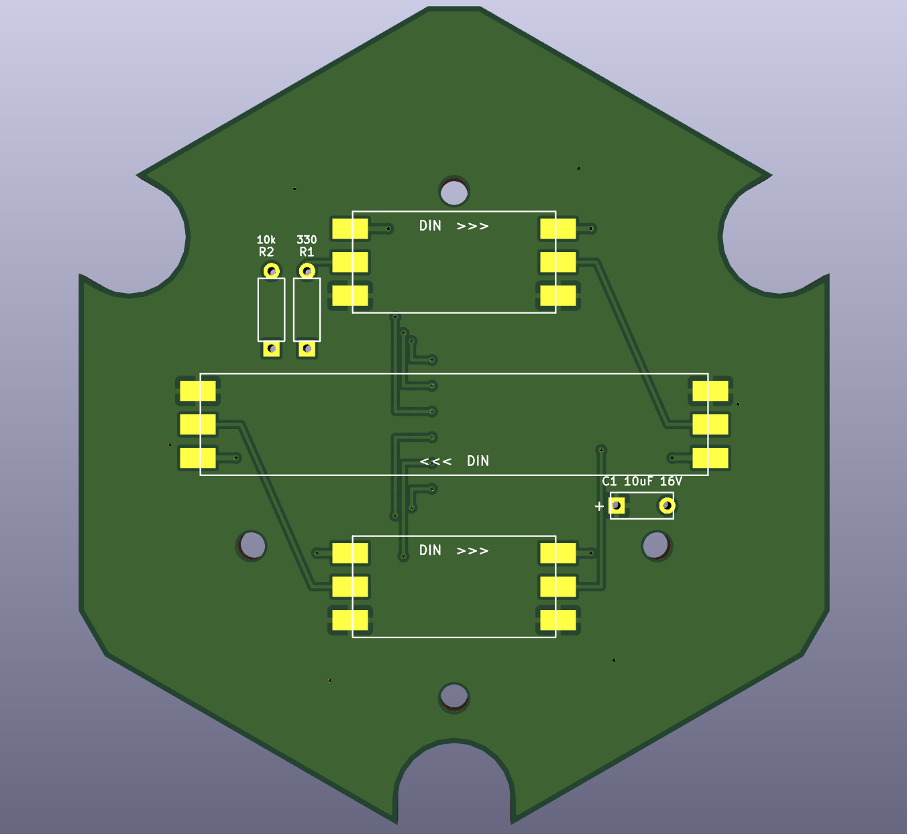
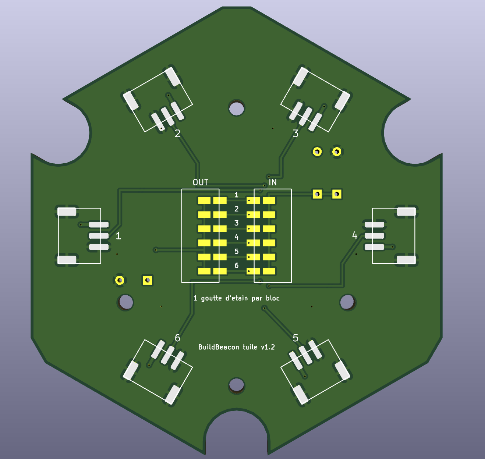
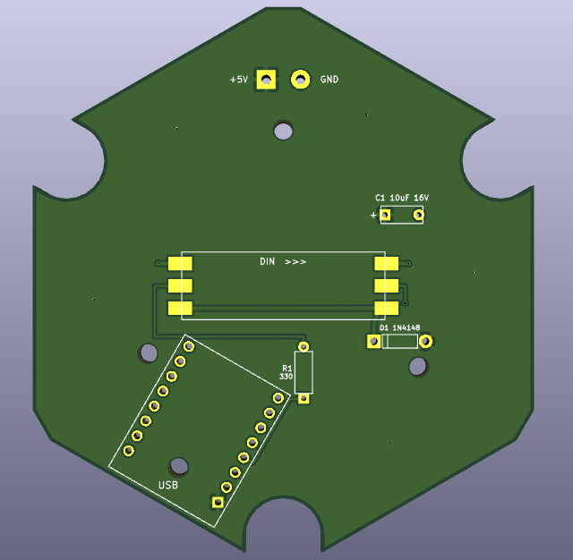
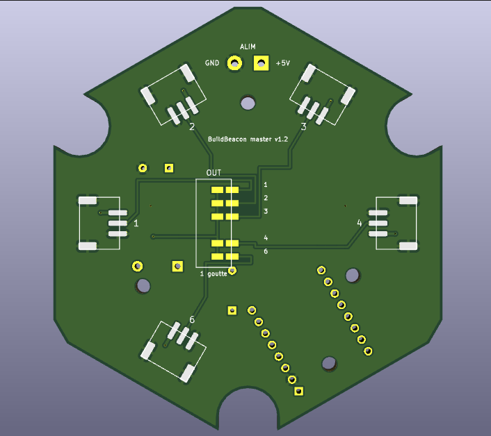

<!-- BuildBeacon — matériel (français). Version 1.5 (2026-11-12) — modèle v1.3 -->
# BuildBeacon — matériel

[English version](README.md)

Tout ce qu'il faut pour fabriquer les tuiles : modèles 3D paramétriques (OpenSCAD) et
circuits imprimés (KiCad), sous licence [CERN-OHL-P-2.0](LICENSE).

> **État :** les modèles 3D sont imprimés et testés. Les cartes **v1.2** sont commandées et
> **pas encore validées** sur une vraie tuile : attendez le retour du premier montage avant
> d'en commander beaucoup, ou montez sans circuit imprimé (voir
> [Montage sans circuit imprimé](#montage-sans-circuit-imprimé)).

## Contenu

```
hardware/
  cad/buildbeacon_tile_v1.3.scad      tuiles, plaques arrière, socle, clips Skådis… (OpenSCAD)
  pcb/buildbeacon_tuile_v1.2.kicad_pcb    carte de la tuile projet (9 LED)
  pcb/buildbeacon_master_v1.2.kicad_pcb   carte de la tuile master (ESP32-C3 + 3 LED)
  pcb/gen_buildbeacon_pcb_v1.2.py     script Python qui génère les deux cartes
  images/                             rendus 3D KiCad des cartes
  LICENSE                             CERN-OHL-P-2.0
```

## Principe

- Chaque tuile hexagonale (80 mm entre côtés plats) contient une carte ronde où l'on soude
  des morceaux de **ruban LED WS2812B** (5 V, 100 LED/m, 10 mm de large).
- Toutes les LED forment **une seule chaîne de données**, pilotée par un **ESP32-C3
  SuperMini** sous [WLED](https://kno.wled.ge/), placé dans la tuile **master**.
- Chaque carte a **6 connecteurs JST PH 3 broches**, un par côté de l'hexagone (5 sur la
  master : le 6ᵉ côté est pris par l'USB). Les tuiles se relient côte à côte par de courts
  câbles JST. Le côté d'entrée et le côté de sortie se **choisissent avec des cavaliers à
  souder** : on peut donc assembler les tuiles dans n'importe quelle forme.
- Brochage identique sur tous les connecteurs : **1 = +5 V, 2 = données, 3 = GND**. Les
  câbles sont « même sens » (broche 1 vers broche 1).

| Tuile | LED | Ordre dans la chaîne |
|---|---|---|
| Master | 3 | LED 0 à 2 |
| Projet n° k | 9 : 2 en haut, 5 points au milieu, 2 en bas | LED `3 + 9·(k−1)` à `3 + 9·k − 1` |

Dans une tuile projet, les données entrent par le ruban du haut (gauche → droite), passent
par les 5 points (droite → gauche), puis le ruban du bas (gauche → droite). Le Hub tient
compte de cet ordre.

## Cartes électroniques

| | Face avant | Dos |
|---|---|---|
| **Tuile projet** |  |  |
| **Master** |  |  |

Cartes à 2 couches, 1,6 mm. Face avant : rubans LED, résistances, condensateur, ESP32 (master).
Dos : connecteurs JST et cavaliers. Plan de cuivre : +5 V sur la face avant, GND au dos.

### Commander les cartes

1. Ouvrir le fichier `.kicad_pcb` dans **KiCad 8 ou 9** et l'enregistrer une fois (KiCad
   signale un format ancien : c'est normal, le fichier est généré par script).
2. **Appuyer sur B** pour remplir les zones de cuivre. *Sans cette étape, les plans +5 V et
   GND ne sont pas fabriqués.*
3. Lancer le **DRC** (contrôle des règles) : 0 erreur attendu.
4. Exporter les Gerbers et les fichiers de perçage, puis commander : 2 couches, 1,6 mm,
   HASL, couleur au choix. Les cartes sont prévues pour être soudées à la main ; aucun
   assemblage par le fabricant n'est nécessaire.

### Liste des composants

**Tuile projet** (par tuile)

| Repère | Composant | Remarque |
|---|---|---|
| — | Carte `buildbeacon_tuile_v1.2` | |
| RB1, RB2, RB3 | Ruban WS2812B 5 V, 100 LED/m, 10 mm : morceaux de 2, 5 et 2 LED | flèches « DIN >>> » sur la carte |
| R1 | Résistance 330 Ω, ¼ W, traversante | 220 à 470 Ω conviennent |
| R2 | Résistance 10 kΩ, ¼ W, traversante | 10 à 100 kΩ conviennent ; évite le scintillement quand l'entrée est en l'air |
| C1 | Condensateur électrolytique 10 µF 16 V, pas 5 mm | couché à plat, **+ sur la pastille carrée** |
| J1 à J6 | JST PH S3B-PH-SM4-TB (CMS, horizontal, pas 2 mm) | seulement sur les côtés utilisés (au moins 1 entrée et 1 sortie) |
| — | 2 gouttes d'étain | 1 dans le bloc IN, 1 dans le bloc OUT |

**Tuile master**

| Repère | Composant | Remarque |
|---|---|---|
| — | Carte `buildbeacon_master_v1.2` | |
| U1 | ESP32-C3 SuperMini + barrettes mâles | USB vers le bord marqué « USB » |
| RB1 | Ruban WS2812B : morceau de 3 LED | |
| D1 | 1N4148 (ou 1N4001 à 1N4007) | **bague vers la pastille carrée**, voir ci-dessous |
| R1 | Résistance 330 Ω | entre GPIO 4 et le ruban |
| C1 | Électrolytique 10 µF 16 V | **+ sur la pastille carrée** |
| J1 à J4, J6 | JST PH S3B-PH-SM4-TB | côtés utilisés seulement |
| J7 | Entrée 5 V « ALIM » (2 fils ou bornier au pas de 5,08 mm) | optionnelle, voir [Alimentation](#alimentation) |
| — | 1 goutte d'étain | bloc OUT |

**Commun** : câbles JST PH 3 broches double extrémité « même sens », inserts laiton
M2,5 × 4 × 3,5 + vis M2,5 × 6 pour fixer la carte, inserts M3 × 5 × 4 + vis M3 (ou aimants
6 × 3 mm) pour fermer la tuile.

### Liste d'achat

Pour une installation de **1 master + N tuiles projet** (exemple : N = 4).

| Article | Quantité | Exemple N = 4 |
|---|---|---|
| Carte `buildbeacon_master_v1.2` | 1 | 1 |
| Carte `buildbeacon_tuile_v1.2` | N | 4 |
| ESP32-C3 SuperMini (avec barrettes mâles) | 1 | 1 |
| Ruban WS2812B 5 V, 100 LED/m, 10 mm | 3 + 9 × N LED (1 m = 100 LED, jusqu'à 10 tuiles) | 39 LED → 1 m |
| Résistance 330 Ω ¼ W | N + 1 | 5 |
| Résistance 10 kΩ ¼ W | N | 4 |
| Condensateur électrolytique 10 µF 16 V, pas 5 mm | N + 1 | 5 |
| Diode 1N4148 (ou 1N4001 à 1N4007) | 1 | 1 |
| Connecteur JST PH S3B-PH-SM4-TB | au moins 2 × N (2 par tuile projet, 1 sur la master et la dernière tuile) ; jusqu'à 6 × N + 5 pour pouvoir tout changer | 8 à 29 |
| Câble JST PH 3 broches double extrémité « même sens » | N (un par liaison entre deux tuiles) | 4 |
| Insert laiton M2,5 × 4 × 3,5 + vis M2,5 × 6 (fixation des cartes) | 4 × (N + 1) | 20 + 20 |
| Fermeture des tuiles : aimants 6 × 3 mm **ou** inserts M3 × 5 × 4 + vis M3 | 6 × (N + 1) aimants **ou** 3 × (N + 1) inserts et vis | 30 aimants ou 15 + 15 |
| Câble USB-C | 1 | 1 |
| Alimentation 5 V (optionnelle, sur J7 « ALIM ») | au moins 0,6 A × N (voir [Alimentation](#alimentation)) | 5 V 3 A |
| Bornier 2 points au pas de 5,08 mm (optionnel, J7) | 1 | 1 |
| Filament PLA ou PETG blanc ou « natural » | coques, plaques arrière, os de liaison, socle ou clips | |

Les fabricants de circuits imprimés livrent souvent par lots de 5 cartes minimum par modèle.
Pour le [montage sans circuit imprimé](#montage-sans-circuit-imprimé), il ne reste que
l'ESP32, le ruban, une résistance de 330 Ω, la fermeture des tuiles et l'alimentation, plus
du fil silicone 22 à 28 AWG (3 fils par liaison).

### Outils

- Imprimante 3D.
- Fer à souder à panne fine (les connecteurs JST sont en CMS), étain, flux.
- Tresse à dessouder (pour déplacer une goutte de cavalier).
- Ciseaux ou cutter pour couper le ruban LED sur les repères de coupe.
- Pince coupante, brucelles ; multimètre conseillé (vérifier qu'il n'y a pas de court-circuit
  entre +5 V et GND avant la première mise sous tension).
- Un ordinateur pour installer WLED sur l'ESP32 (voir [Configurer WLED](#configurer-wled)).

### Pourquoi D1 sur la master ?

L'ESP32 envoie des données en 3,3 V, alors que les LED alimentées en 5 V attendent au moins
environ 3,5 V : à forte luminosité, la première LED se trompe et la chaîne scintille. D1
fait baisser l'alimentation des 3 LED de la master d'environ 0,7 V (≈ 4,4 V) : elles lisent
alors sans faute le signal 3,3 V et le renvoient en 5 V aux tuiles suivantes.

### Cavaliers : choisir l'entrée et la sortie

Au dos, les cavaliers sont rangés en blocs de 6 rangées numérotées **1 à 6**, comme les
côtés (le numéro de chaque côté est imprimé à côté de son connecteur).

- **Tuile projet** : bloc **IN** = côté par lequel arrivent les données ; bloc **OUT** = côté
  vers la tuile suivante. **Une goutte d'étain par bloc**, qui relie les deux pastilles de la
  rangée choisie. Exemple : données qui arrivent par le côté 4 et repartent par le côté 1 →
  goutte sur la rangée 4 du bloc IN et sur la rangée 1 du bloc OUT.
- **Master** : un seul bloc **OUT** (côtés 1, 2, 3, 4 et 6).
- La dernière tuile de la chaîne n'a pas besoin de goutte dans son bloc OUT.
- Pour changer : retirer la goutte avec de la tresse à dessouder.

### Alimentation

- **Petite installation** (master + 2 ou 3 tuiles, luminosité limitée) : l'USB-C de
  l'ESP32 suffit.
- **Plus de tuiles** : alimentation 5 V externe sur **J7 « ALIM »** de la master (carré =
  +5 V, rond = GND). Le +5 V et le GND passent par tous les connecteurs JST.
- **Ne jamais brancher l'USB et l'alimentation externe en même temps.** Pour programmer
  l'ESP32, débrancher d'abord l'alimentation externe.
- Comptez jusqu'à 60 mA par LED en blanc à fond (≈ 0,55 A par tuile projet). Réglez le
  limiteur de courant de WLED sur la valeur de votre alimentation (850 à 1 500 mA en USB).
- Luminosité conseillée : 128 (50 %) au départ.

### Régénérer les cartes

Les cartes sont produites par `gen_buildbeacon_pcb_v1.2.py` (Python 3, sans dépendance) :

```sh
cd hardware/pcb
python3 gen_buildbeacon_pcb_v1.2.py          # tuile projet
python3 gen_buildbeacon_pcb_v1.2.py --logo   # master
```

Toute modification de carte change la variable `VERSION` du script (et donc le nom des
fichiers et le texte imprimé au dos de la carte).

## Modèles 3D

Un seul fichier paramétrique : [`cad/buildbeacon_tile_v1.3.scad`](cad/buildbeacon_tile_v1.3.scad),
à ouvrir dans [OpenSCAD](https://openscad.org/) (2021 ou plus récent). Réglez les paramètres
dans le **Customizer**, choisissez la pièce avec `part`, faites le rendu (**F6**) puis
exportez en STL.

**Depuis l'interface web du Hub** : l'onglet **Impression 3D** liste les pièces de votre mur
(une coque par tuile avec son nom, les plaques arrière, les os de chien) et télécharge
`buildbeacon_tile_v1.3.json`, un jeu de paramètres par pièce. Placez-le à côté du fichier
`.scad` : le Customizer propose les jeux dans sa liste, prêts à rendre ; l'onglet donne aussi
les commandes qui rendent toutes les pièces d'un coup (`openscad -p … -P <jeu> -o <jeu>.stl`).

### Pièces (`part`)

| `part` | Pièce |
|---|---|
| `tile` | coque de la tuile (façade avec le texte) |
| `back` | plaque arrière (support des LED ou de la carte) |
| `both` | les deux, pour l'aperçu |
| `links` / `link_test` | « os de chien » qui relient les plaques arrière / 4 os de test de serrage |
| `stand` | socle de bureau (tuiles en rangée) |
| `skadis_clips` | clips pour panneau IKEA Skådis |
| `cable_clips`, `plugs` | clips à câbles, bouchons d'encoche |
| `letters`, `base`, `led_bridge`, `knockout_test` | options (voir les commentaires du fichier) |

### Réglages principaux

- **Texte** : `label` (nom du projet), `label2`, `font`, `text_size`. Tuile master :
  `master = true` et `master_logo = true` (logo à la place du nom).
- **Style** : `glow` (une couleur, texte aminci qui brille plus), `swap` (changement de
  filament : façade noire, lettres blanches), `dark_face`, `stencil`.
- **Avec les cartes** : `led_mount = "pcb"`, `pcb_fix = "insert"` (inserts M2,5 × 4 × 3,5,
  logement `pcb_insert_d = 3.2`).
- **Fermeture de la tuile** : `screw_type = "magnet"` (aimants 6 × 3 mm) ou `"insert"`
  (inserts M3 × 5 × 4, logement `insert_d = 3.6`).
- **Liaison des plaques** : `link_fit` règle le serrage des os de chien ; imprimez d'abord
  `part = "link_test"` pour trouver la bonne valeur.

### Impression

- PLA ou PETG blanc ou « natural » pour la coque (la lumière traverse la façade).
- Coque : **façade sur le plateau**, sans support. Plaque arrière : nervures vers le haut.
  Socle et clips : à plat.
- Les inserts laiton se posent au fer à souder (≈ 220 °C pour le PLA).

## Montage sans circuit imprimé

Avec `led_mount = "strip"`, les morceaux de ruban se collent directement sur la plaque
arrière, entre des rails, et se relient par des fils (3 fils silicone 22 à 28 AWG). Même
ordre de chaîne, mêmes LED, aucune carte à commander. Ajoutez une résistance de 330 Ω entre
le GPIO 4 de l'ESP32 et la première LED.

## Configurer WLED

Voir le [README principal](../README.fr.md#avec-les-tuiles) : GPIO 4, WS281x, ordre GRB,
longueur = 3 + 9 × nombre de tuiles projet, limiteur de courant réglé.

## Licence

Matériel (ce dossier) : [CERN-OHL-P-2.0](LICENSE). Logiciel : [MIT](../LICENSE).
