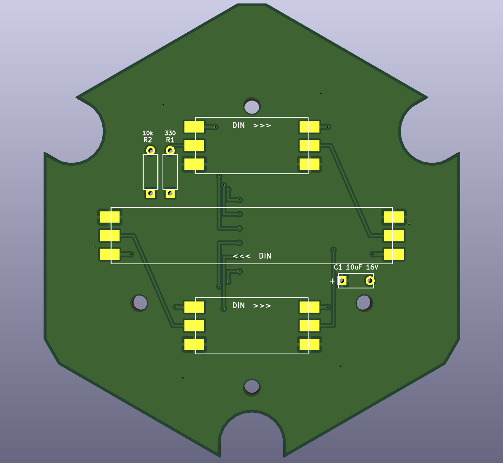
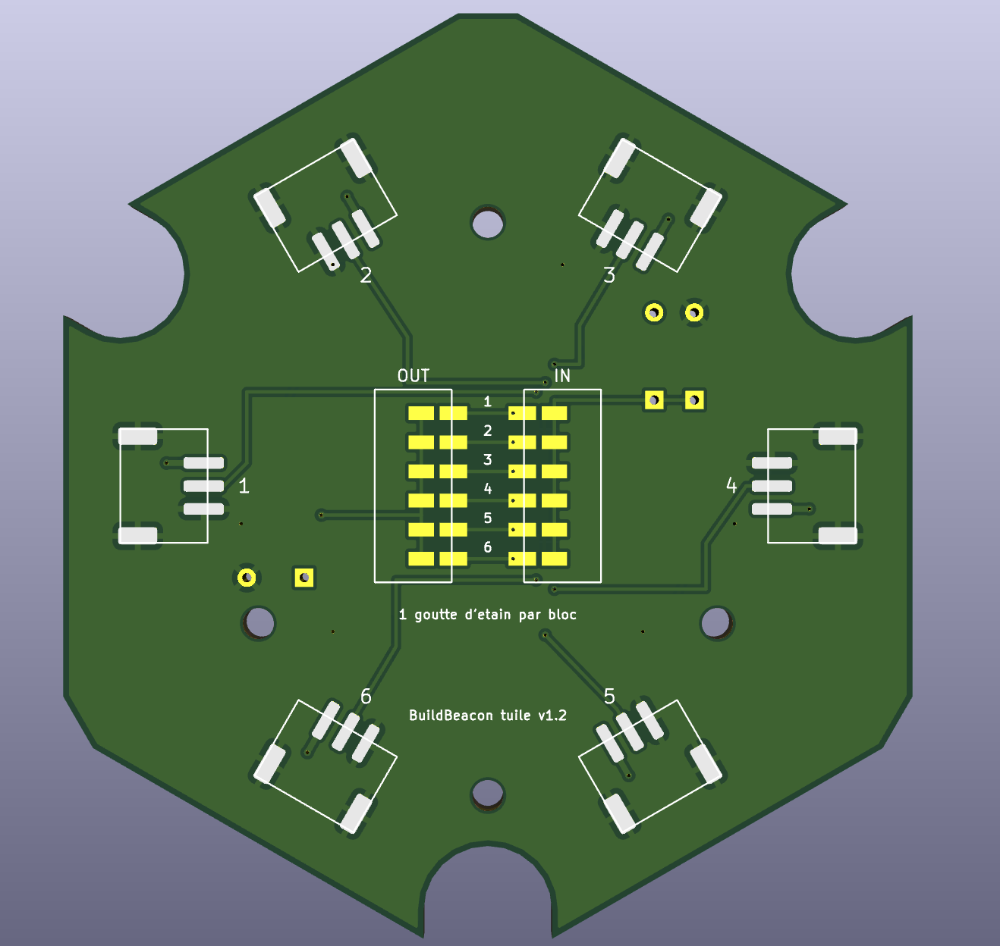
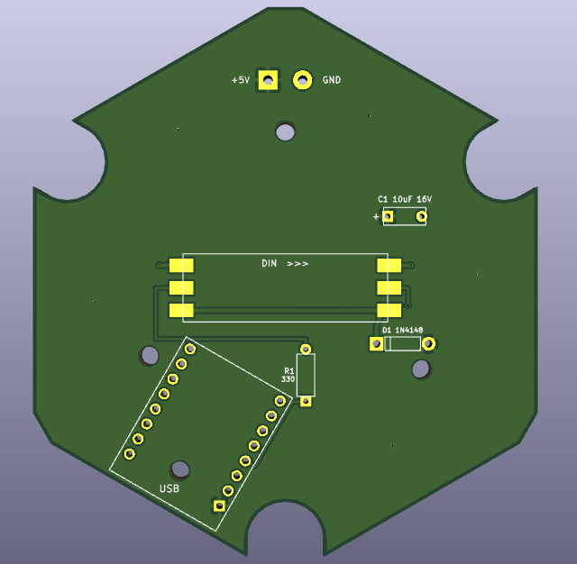
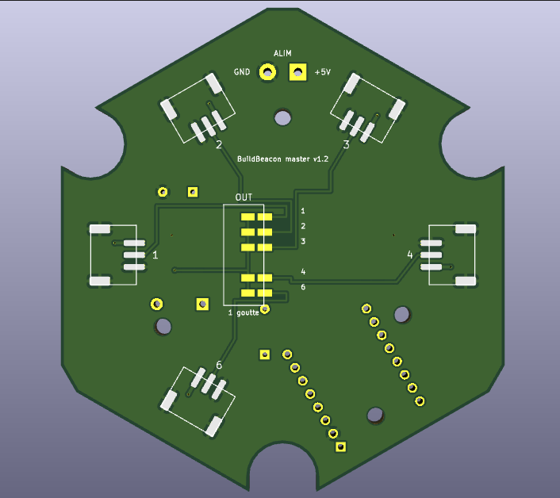

<!-- BuildBeacon — hardware (English). Version 1.4 (2026-11-12) — model v1.2 (comments in English) -->
# BuildBeacon — hardware

[Version française](README.fr.md)

Everything you need to build the tiles: parametric 3D models (OpenSCAD) and circuit boards
(KiCad), licensed under [CERN-OHL-P-2.0](LICENSE).

> **Status:** the 3D models are printed and tested. The **v1.2** boards are ordered and
> **not yet validated** on a real tile: wait for feedback from the first build before ordering
> many, or build without boards (see [Building without boards](#building-without-boards)).

## Contents

```
hardware/
  cad/buildbeacon_tile_v1.2.scad      tiles, back plates, stand, Skådis clips… (OpenSCAD)
  pcb/buildbeacon_tuile_v1.2.kicad_pcb    project tile board (9 LEDs)
  pcb/buildbeacon_master_v1.2.kicad_pcb   master tile board (ESP32-C3 + 3 LEDs)
  pcb/gen_buildbeacon_pcb_v1.2.py     Python script that generates both boards
  images/                             KiCad 3D renders of the boards
  LICENSE                             CERN-OHL-P-2.0
```

File names and on-board labels are in French: *tuile* = tile, *ALIM* = power input,
*cavaliers* = solder jumpers, *1 goutte d'étain par bloc* = one solder blob per block.

## Overview

- Each hexagonal tile (80 mm across flats) holds a round board carrying short pieces of
  **WS2812B LED strip** (5 V, 100 LEDs/m, 10 mm wide).
- All LEDs form **a single data chain**, driven by an **ESP32-C3 SuperMini** running
  [WLED](https://kno.wled.ge/), housed in the **master** tile.
- Each board has **6 JST PH 3-pin connectors**, one per side of the hexagon (5 on the
  master: the 6th side is taken by USB). Neighbouring tiles are linked with short JST cables.
  The input and output sides are **selected with solder jumpers**, so tiles can be arranged
  in any shape.
- Same pinout on every connector: **1 = +5 V, 2 = data, 3 = GND**. Cables are "same
  direction" (pin 1 to pin 1).

| Tile | LEDs | Position in the chain |
|---|---|---|
| Master | 3 | LEDs 0 to 2 |
| Project tile no. k | 9: 2 at the top, 5 dots in the middle, 2 at the bottom | LEDs `3 + 9·(k−1)` to `3 + 9·k − 1` |

Inside a project tile, data enters the top strip (left → right), goes through the 5 dots
(right → left), then the bottom strip (left → right). The Hub knows this order.

## Circuit boards

| | Front | Back |
|---|---|---|
| **Project tile** |  |  |
| **Master** |  |  |

2-layer, 1.6 mm boards. Front: LED strips, resistors, capacitor, ESP32 (master). Back: JST
connectors and solder jumpers. Copper pours: +5 V on the front, GND on the back.

### Ordering the boards

1. Open the `.kicad_pcb` file in **KiCad 8 or 9** and save it once (KiCad reports an old
   file format: this is expected, the file is generated by a script).
2. **Press B** to fill the copper zones. *Skip this and the +5 V and GND pours will not be
   manufactured.*
3. Run the **DRC**: 0 errors expected.
4. Export Gerbers and drill files, then order: 2 layers, 1.6 mm, HASL, any colour. The
   boards are designed for hand soldering; no factory assembly is needed.

### Bill of materials

**Project tile** (per tile)

| Ref | Part | Notes |
|---|---|---|
| — | Board `buildbeacon_tuile_v1.2` | |
| RB1, RB2, RB3 | WS2812B strip, 5 V, 100 LEDs/m, 10 mm: pieces of 2, 5 and 2 LEDs | follow the "DIN >>>" arrows |
| R1 | 330 Ω resistor, ¼ W, through-hole | 220 to 470 Ω is fine |
| R2 | 10 kΩ resistor, ¼ W, through-hole | 10 to 100 kΩ is fine; prevents flicker when the input floats |
| C1 | 10 µF 16 V electrolytic capacitor, 5 mm pitch | laid flat, **+ on the square pad** |
| J1 to J6 | JST PH S3B-PH-SM4-TB (SMD, horizontal, 2 mm pitch) | only on the sides you use (at least 1 in, 1 out) |
| — | 2 solder blobs | 1 in the IN block, 1 in the OUT block |

**Master tile**

| Ref | Part | Notes |
|---|---|---|
| — | Board `buildbeacon_master_v1.2` | |
| U1 | ESP32-C3 SuperMini + pin headers | USB towards the edge marked "USB" |
| RB1 | WS2812B strip: piece of 3 LEDs | |
| D1 | 1N4148 (or 1N4001 to 1N4007) | **band towards the square pad**, see below |
| R1 | 330 Ω resistor | between GPIO 4 and the strip |
| C1 | 10 µF 16 V electrolytic | **+ on the square pad** |
| J1 to J4, J6 | JST PH S3B-PH-SM4-TB | used sides only |
| J7 | 5 V input "ALIM" (2 wires or a 5.08 mm terminal block) | optional, see [Power](#power) |
| — | 1 solder blob | OUT block |

**Common**: JST PH 3-pin double-ended "same direction" cables, M2.5 × 4 × 3.5 brass inserts
+ M2.5 × 6 screws to hold the board, M3 × 5 × 4 inserts + M3 screws (or 6 × 3 mm magnets) to
close the tile.

### Shopping list

For a setup of **1 master + N project tiles** (example: N = 4).

| Item | Quantity | Example N = 4 |
|---|---|---|
| Board `buildbeacon_master_v1.2` | 1 | 1 |
| Board `buildbeacon_tuile_v1.2` | N | 4 |
| ESP32-C3 SuperMini (with pin headers) | 1 | 1 |
| WS2812B strip, 5 V, 100 LEDs/m, 10 mm | 3 + 9 × N LEDs (1 m = 100 LEDs, up to 10 tiles) | 39 LEDs → 1 m |
| 330 Ω ¼ W resistor | N + 1 | 5 |
| 10 kΩ ¼ W resistor | N | 4 |
| 10 µF 16 V electrolytic capacitor, 5 mm pitch | N + 1 | 5 |
| 1N4148 diode (or 1N4001 to 1N4007) | 1 | 1 |
| JST PH S3B-PH-SM4-TB connector | at least 2 × N (2 per project tile, 1 on the master and on the last tile); up to 6 × N + 5 to allow any layout | 8 to 29 |
| JST PH 3-pin double-ended "same direction" cable | N (one per link between two tiles) | 4 |
| M2.5 × 4 × 3.5 brass insert + M2.5 × 6 screw (board mounting) | 4 × (N + 1) | 20 + 20 |
| Tile closing: 6 × 3 mm magnets **or** M3 × 5 × 4 inserts + M3 screws | 6 × (N + 1) magnets **or** 3 × (N + 1) inserts and screws | 30 magnets or 15 + 15 |
| USB-C cable | 1 | 1 |
| 5 V power supply (optional, on J7 "ALIM") | at least 0.6 A × N (see [Power](#power)) | 5 V 3 A |
| 2-pin 5.08 mm terminal block (optional, J7) | 1 | 1 |
| White or "natural" PLA or PETG filament | shells, back plates, links, stand or clips | |

Board makers often ship a minimum of 5 boards per design.
For [building without boards](#building-without-boards), you only need the ESP32, the
strip, one 330 Ω resistor, the tile closing parts and the power supply, plus 22 to 28 AWG
silicone wire (3 wires per link).

### Tools

- 3D printer.
- Fine-tip soldering iron (the JST connectors are SMD), solder, flux.
- Desoldering braid (to move a jumper blob).
- Scissors or a cutter to cut the LED strip on its cut marks.
- Side cutters, tweezers; a multimeter is recommended (check there is no short between +5 V
  and GND before powering up for the first time).
- A computer to install WLED on the ESP32 (see [Configuring WLED](#configuring-wled)).

### Why D1 on the master?

The ESP32 sends 3.3 V data, while LEDs powered at 5 V expect at least about 3.5 V: at high
brightness the first LED misreads the signal and the chain flickers. D1 drops the supply of
the 3 master LEDs by about 0.7 V (≈ 4.4 V): they then read the 3.3 V signal reliably and pass
it on at 5 V to the following tiles.

### Solder jumpers: choosing input and output

On the back, the jumpers are grouped in blocks of 6 rows numbered **1 to 6**, like the sides
(each side's number is printed next to its connector).

- **Project tile**: **IN** block = side where data comes in; **OUT** block = side towards the
  next tile. **One solder blob per block**, bridging the two pads of the chosen row.
  Example: data arrives on side 4 and leaves on side 1 → blob on row 4 of IN and row 1 of OUT.
- **Master**: a single **OUT** block (sides 1, 2, 3, 4 and 6).
- The last tile of the chain needs no blob in its OUT block.
- To change it: remove the blob with desoldering braid.

### Power

- **Small setup** (master + 2 or 3 tiles, limited brightness): the ESP32's USB-C is enough.
- **More tiles**: external 5 V supply on the master's **J7 "ALIM"** (square = +5 V,
  round = GND). +5 V and GND run through every JST connector.
- **Never connect USB and the external supply at the same time.** Unplug the external supply
  before flashing the ESP32.
- Budget up to 60 mA per LED at full white (≈ 0.55 A per project tile). Set WLED's current
  limiter to your supply's rating (850 to 1,500 mA on USB).
- Recommended brightness: start at 128 (50 %).

### Regenerating the boards

The boards are produced by `gen_buildbeacon_pcb_v1.2.py` (Python 3, no dependencies):

```sh
cd hardware/pcb
python3 gen_buildbeacon_pcb_v1.2.py          # project tile
python3 gen_buildbeacon_pcb_v1.2.py --logo   # master
```

Any board change bumps the script's `VERSION` variable (and so the file names and the text
printed on the back of the board).

## 3D models

A single parametric file: [`cad/buildbeacon_tile_v1.2.scad`](cad/buildbeacon_tile_v1.2.scad),
to open in [OpenSCAD](https://openscad.org/) (2021 or later). Set the parameters in the
**Customizer**, pick the part with `part`, render (**F6**) and export to STL.

**From the web interface of the Hub**: the **3D printing** tab lists the parts of your wall
(a shell per tile with its name, the back plates, the dog bones) and downloads
`buildbeacon_tile_v1.2.json`, one parameter set per part. Put it next to the `.scad` file:
the Customizer offers the sets in its list, ready to render; the tab also gives the
commands that render every part at once (`openscad -p … -P <set> -o <set>.stl`).

### Parts (`part`)

| `part` | Part |
|---|---|
| `tile` | tile shell (face with the text) |
| `back` | back plate (holds the LEDs or the board) |
| `both` | both, for preview |
| `links` / `link_test` | "dog bones" joining the back plates / 4 test bones for fit |
| `stand` | desk stand (tiles in a row) |
| `skadis_clips` | clips for an IKEA Skådis pegboard |
| `cable_clips`, `plugs` | cable clips, notch plugs |
| `letters`, `base`, `led_bridge`, `knockout_test` | options (see the comments in the file) |

### Main settings

- **Text**: `label` (project name), `label2`, `font`, `text_size`. Master tile:
  `master = true` and `master_logo = true` (logo instead of a name).
- **Style**: `glow` (one colour, thinned text shines brighter), `swap` (filament change:
  black face, white letters), `dark_face`, `stencil`.
- **With the boards**: `led_mount = "pcb"`, `pcb_fix = "insert"` (M2.5 × 4 × 3.5 inserts,
  hole `pcb_insert_d = 3.2`).
- **Closing the tile**: `screw_type = "magnet"` (6 × 3 mm magnets) or `"insert"` (M3 × 5 × 4
  inserts, hole `insert_d = 3.6`).
- **Joining the plates**: `link_fit` sets how tight the dog bones are; print
  `part = "link_test"` first to find the right value.

### Printing

- White or "natural" PLA or PETG for the shell (light shines through the face).
- Shell: **face down on the bed**, no supports. Back plate: ribs up. Stand and clips: flat.
- Brass inserts go in with a soldering iron (≈ 220 °C for PLA).

## Building without boards

With `led_mount = "strip"`, the strip pieces are glued straight onto the back plate between
rails and wired together (3 silicone wires, 22 to 28 AWG). Same chain order, same LEDs, no
boards to order. Add a 330 Ω resistor between the ESP32's GPIO 4 and the first LED.

## Configuring WLED

See the [main README](../README.md#with-the-tiles): GPIO 4, WS281x, GRB order,
length = 3 + 9 × number of project tiles, current limiter set.

## License

Hardware (this folder): [CERN-OHL-P-2.0](LICENSE). Software: [MIT](../LICENSE).
